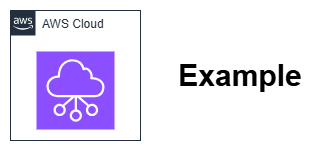

# Conventions

This section explains several conventions used in this best practices guide.

## Architecture Diagrams

### AWS Architecture Icons

Use the [most recent set of AWS Architecture Icons](https://aws.amazon.com/architecture/icons/) in any architecture diagrams. Only use icons for what they actually represent.

### Format and tooling

Provide architecture diagrams in PNG file format with a light neutral background, such as white. Leave a border of 8px around all elements. Each diagram needs to be accompanied by the source in [draw.io](https://www.drawio.com/) format to allow future modifications.

#### File Organization

Store files using this structure:

```
content/
  assets/
    foundation/
      vpc-setup-diagram.png
      vpc-setup-diagram.drawio
    security/
      network-acl-flow.png
      network-acl-flow.drawio
```

#### Technical Requirements

* **File format**: PNG with transparent background
* **Dimensions**: Maximum 1200px wide, maintain aspect ratio. Diagrams must remain readable when scaled to 700px width.
* **File size**: Keep under 500KB for optimal loading
* **Resolution**: 72-96 DPI for web display

#### Light and dark mode compatibility

Diagrams must be usable on both the light and dark color schemes. To achieve this:

* **Use a transparent background** — not white. This allows the diagram to adapt to both color schemes.
* **Use `#7E7E7E` for text and lines on the transparent background** — not black (`#000000`) or white (`#FFFFFF`). This gray provides approximately equal contrast against both the light background (`#FFFFFF`) and the dark background (`#1e1e1e`).
* **Text inside colored nodes** (with filled backgrounds) can use white or another color appropriate for the node's fill — the `#7E7E7E` rule applies only to elements that sit directly on the transparent background.

!!! note "Contrast ratio limitation"
    The `#7E7E7E` gray achieves approximately 4.1:1 contrast against both the light and dark backgrounds. This is slightly below the WCAG AA minimum of 4.5:1. This is an accepted trade-off — no single color can achieve 4.5:1 contrast against both a white and a near-black background simultaneously (the ranges are mathematically mutually exclusive). The `#7E7E7E` midpoint provides the best balanced readability across both schemes without requiring duplicate image files.

{ width="300" }
/// caption
Example image caption - [Drawio Source](../assets/community/Example.drawio)
///

### Accessibility

Create architecture diagrams with accessibility in mind. Text (or lines) and the background should have a contrast ratio of [at least 4.5:1](https://www.w3.org/WAI/WCAG21/Understanding/contrast-minimum.html). Generally, white or black on a strongly contrasting background is the best choice.

#### Accessibility Examples

**Good contrast combinations:**

* Black text (#000000) on white background (#FFFFFF) - 21:1 ratio
* Dark gray text (#16191F) on white background - 12.6:1 ratio

**Poor contrast combinations:**

* Light gray text (#CCCCCC) on white background - 1.6:1 ratio ❌
* Yellow text on white background - 1.1:1 ratio ❌

#### Guidelines

* **Keep it simple**: Create diagrams that are as simple as possible; split content over several diagrams if needed. If you can't sketch it on a napkin, it's too complicated.

* **Use double encoding**: Avoid using color as a sole indicator of difference.

* **Use alt text thoughtfully**: Include alt text on visuals to briefly describe the content.

### Diagram styling

Use the following guidance to align your diagram's style with AWS' visual style and language. Does your diagram check off all these element guidelines?

* **Background Color**: Use white (#FFFFFF) as the background color. Do not leave the background transparent.

* **Lines and arrows**: Lines should have a minimum thickness/width of 1 pt. Use solid lines for primary connections and containers. Secondary connections and containers can be represented as Dashed lines. For arrow pointer styles use open arrow pointers over closed ones.

* **Colors**: Do not modify the colors provided by official icon libraries - use as is because they contain semantic meaning (e.g., certain colors represent a service category). If you need to add additional colors to your diagram, make sure the color values are included within the [AWS Brand color palette](https://design.amazon.com/styleguide/9188F3F120Af/aws/visual-identity/color/).

* **Typography (fonts)**: Use the weight Regular in most cases. Bold can be used to provide extra emphasis if needed. Do not use Thin or Light (they fail accessibility standards below most diagram-needed font sizes). The minimum font size should be 12px. Use the color #16191F or #000000 for most icon/illustration labels. In diagrams *italics* is preferred over ^^underlines^^. (In a diagram with arrows/lines, underlines can add unnecessary visual noise).

* **Labels and text**: Center align the label with the icon and place it under the icon. Do not embed explanatory text into images - it neither accessible nor localizable. Use only short labels for each illustrative object or icon. If you'd like to highlight specific parts of the diagram with explanatory text, use callouts. This is better for accessibility, localization, and regional compliance.

* **Outside framing**: Apply a padding of 8px equally to the top, bottom, left, and right of your image. Do not apply a visible outside border to the diagram, and we recommend staying away from border shadows and fades.

## Representing IP addresses

Use approved documentation ranges to avoid conflicts with real networks and ensure examples work universally. Our automated validation checks enforce these standards.

### Example IP ranges and addresses

Use one of the multiple available [documentation ranges](https://en.wikipedia.org/wiki/Reserved_IP_addresses) for IPv4 and IPv6 addresses, when documenting "public" IP addresses. A good example would be ```192.0.2.0/24``` for an IPv4 range or ```2001:db8::/32``` for an IPv6 range.

For "internal range" examples use [RFC1918](https://datatracker.ietf.org/doc/html/rfc1918) (```10.0.0.0/8, 172.16.0.0/12, 192.168.0.0/16```), [RFC6598](https://datatracker.ietf.org/doc/html/rfc6598) (```100.64.0.0/10```), or [RFC6815](https://datatracker.ietf.org/doc/html/rfc6815) space (```198.19.0.0/16```), which is all supported within VPC.

#### Complete Network Examples

**Multi-tier VPC setup:**

```
VPC: 10.0.0.0/16
  Public subnet: 10.0.1.0/24
  Private subnet: 10.0.2.0/24
  Database subnet: 10.0.3.0/24
```

### Representing IPv6 addresses and networks

Adhere to [RFC5952](https://datatracker.ietf.org/doc/html/rfc5952) when representing IPv6 addresses.

| <!-- --> | Example |
| -------- | -------- |
| :material-check:{ style="color: #4DB6AC" } **Correct** | ```2001:db8:0:1234::``` |
| :material-close:{ style="color: #EF5350" } **Wrong** | ```2001:0db8:0000:1234::``` |
| :material-close:{ style="color: #EF5350" } **Wrong** | ```2001:DB8:0:1234::``` |
| :material-close:{ style="color: #EF5350" } **Wrong** | ```2001:0DB8:0000:1234::``` |

## Console Screenshots

The AWS console goes through frequent changes, and those images can be hard to update while keeping a consistent look between multiple screenshots in a section. Furthermore, customers should be investing in automating AWS deployments, and using the console only for review, monitoring, or tinkering. Thus, the use of screenshots should be avoided for most cases, including:

* How to configure a service
* Basic AWS operations

Consider carefully before using them for:

* Showing graphical output in the console (maps, charts, and the like)
* Highlighting a single function or item in the console, especially if explaining where it is would be complex.

## Quick Checklist

Before submitting diagrams:

* [ ] Uses latest AWS Architecture Icons
* [ ] PNG format with white background
* [ ] Includes matching .drawio source file
* [ ] Text contrast ratio ≥ 4.5:1
* [ ] Font size ≥ 12px
* [ ] Uses approved IP ranges
* [ ] File size < 500KB
* [ ] Descriptive alt text included

## Use of Generative AI

The use of generative AI tools (such as Amazon Q, Claude, ChatGPT, GitHub Copilot, or similar) is permitted for producing text content and generating images or diagrams. AI-assisted content must meet the same quality standards as human-written content — the project's [philosophy](philosophy.md) and the conventions on this page apply regardless of how the content was produced.

**Requirements for AI-generated content:**

* **Human review is mandatory.** All AI-generated text and images must be reviewed by a human contributor for technical accuracy, tone, and adherence to project conventions before creating a pull request. AI output is a draft, not a finished product.
* **Technical accuracy is the reviewer's responsibility.** AI tools can produce plausible-sounding content that is factually incorrect, outdated, or subtly misleading. Reviewers must verify service capabilities, pricing details, API behaviors, and architectural recommendations against current AWS documentation.
* **Do not disclose AI usage in the content itself.** The reader should not be able to tell whether content was written by a human or assisted by AI. The quality bar is the same either way.
* **Steering conventions exist for AI tools.** This project includes a `.kiro/steering/content-conventions.md` file that provides structural and formatting guidance to AI tools working in the repository. Contributors using AI tools should ensure their tooling picks up this file for consistent output.
* **Images generated by AI must meet the same standards.** AI-generated diagrams must use approved AWS Architecture Icons, meet accessibility contrast requirements, and include a `.drawio` source file for future editing — the same as any human-created diagram.

## Changelog

The [changelog](../changelog.md) records content changes that alter a reader's decision. It is exempt from the page-structure rules that apply to other content pages: it has no prerequisites admonition, diagram, opening-paragraph requirements, best practices section, or related pages section. It still follows the rest of these conventions and must pass the same validation checks, including the AWS service naming, no-Latin-abbreviation, and no-specific-pricing rules.

**Inclusion rule:** an entry belongs in the changelog if a reader who applied the old version of the page would now make a different decision. Typo and grammar fixes, dead-link fixes, lint or formatting changes, CI and GitHub Actions changes, SEO and site metadata, review-feedback follow-ups inside a pull request, and image or icon fixes that don't change meaning are not listed. The unit of an entry is the merged pull request, not the commit.

Every entry uses one of four change types with a fixed icon. Each type maps to one GitHub label:

| Icon | Type | Label | Use when |
| ---- | ---- | ----- | -------- |
| 🆕 | New guidance | `changelog:new` | A new best practice, section, or service capability is documented |
| 🔄 | Changed recommendation | `changelog:changed` | The advice or default choice differs from before |
| 🔧 | Correction | `changelog:correction` | A factual, technical, or diagram error is fixed in a way that changes what a reader would do |
| 🗑️ | Removed | `changelog:removed` | Guidance, a recommendation, or a section is retired |

The label is the authoritative type. A pull request with exactly one `changelog:*` label belongs in the changelog with that type, and a pull request without one is not published. Maintainers correct a wrong type by swapping the label, so no edit to the pull request description is needed.

Entries are grouped by the month the pull request merged, newest first, and follow this format:

```markdown
* 🔄 **Changed recommendation** — [Page title](path/to/page.md#anchor): Previously X. Now Y. ([#123](https://github.com/aws/aws-networking-best-practices/pull/123))
```

* **Link to a real anchor.** Link to the affected page and, where possible, to the heading that contains the change.
* **State both sides for 🔄 and 🗑️.** Write "Previously X. Now Y." so a reader, or an AI model with stale training data, sees what no longer applies.
* **Keep it to one or two sentences.** Describe what changed and why it matters for a decision.

Pull request authors propose entries in the "Changelog entry" section of the pull request template, including a suggested type. A maintainer applies the `changelog:*` label that sets the final type, and the `scripts/generate-changelog.sh` script formats the labeled entries. If the author's suggested type and the label disagree, the label wins and the script prints a warning. See [Changelog entries](making-a-pull-request.md#changelog-entries) for the full flow.

## Pricing References

When discussing cost implications of networking services and architectural decisions:

* **Reference pricing dimensions, not specific dollar amounts.** AWS pricing varies by Region and changes frequently. Describe *what* you are charged for (per-hour, per-GB processed, per-attachment, per-request) and how services compare in relative terms, but do not include specific prices (e.g., "$0.045/GB").
* **Use relative comparisons.** Statements like "VPC peering has no data processing charge while Transit Gateway charges per-GB" or "DNS Firewall costs orders of magnitude less than Network Firewall for the same traffic volume" are durable and accurate across Regions and over time.
* **Link to official pricing pages.** When cost is a decision factor, include a link to the relevant AWS pricing page so readers can look up current values for their Region.
