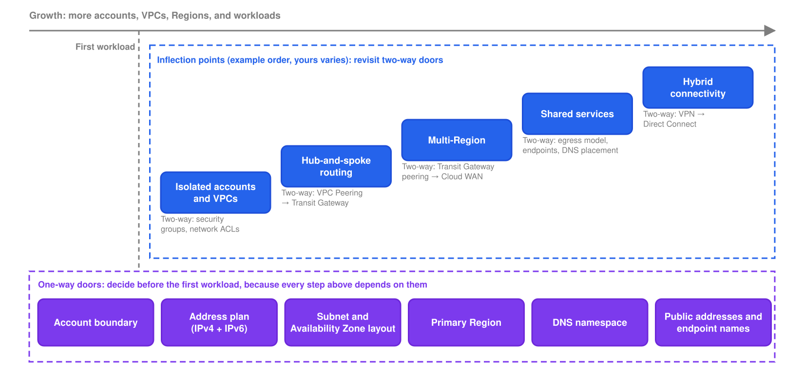

# Decision Framework: One-Way and Two-Way Doors

!!! info "Prerequisites"
    This page assumes familiarity with the five pillars in the [Introduction](index.md) and the multi-account model in [AWS Organizations](foundation/organizations.md). Review those first if you're new to this guide.

A networking decision is a one-way door when reversing it means rebuilding or migrating the workloads that depend on it, and a two-way door when a configuration change reverses it. In AWS networking, the primary CIDR block of a VPC, the account boundary, subnet and Availability Zone placement, the IPv6 address plan, and public addresses that other parties depend on are one-way doors. The choice between VPC Peering, AWS Transit Gateway, and AWS Cloud WAN is a two-way door, because the three can run side by side during a migration.

The cost of a wrong network decision is rarely the fix itself. Every workload built on a network inherits its address plan, account boundary, and subnet layout, so reversal cost grows with each dependent workload. A door that is cheap to change before the first workload can be effectively one-way after hundreds of workloads depend on it. Two tools address this. The door type asks how hard a decision is to undo. Inflection points identify the moments when a current design stops fitting.

This page is a register, not a design guide. It classifies decisions as one-way or two-way doors, names the triggers that reopen them, and links to the page that owns the detail for each decision. The door terms come from [Amazon's 2015 letter to shareholders](https://ir.aboutamazon.com/annual-reports-proxies-and-shareholder-letters/default.aspx), which separates hard-to-reverse decisions that need deliberation from reversible decisions that should be made quickly.

/// caption
Decision framework overview — [Drawio Source](assets/decision-framework/decision-framework-overview.drawio)
///

## The combined rule

Door type decides when you decide. Inflection points decide when you revisit.

| Door type | Decide | Revisit | Reversal involves |
| --- | --- | --- | --- |
| **One-way** | Before the first workload, with input from the platform, security, and network owners | Before each inflection point, to confirm the decision still supports the next transition | Rebuilding or migrating dependent workloads, or coordinating with parties you don't control |
| **Two-way** | At the trigger, not before. Choose the simplest design that fits today | At each inflection point | A configuration change, a parallel run, or a staged migration |

***Key insight:*** *An inflection point is not a reason to defer a one-way door. Each transition depends on one-way decisions made earlier, so a design that moves from one Region to several needs per-Region address blocks and a DNS hierarchy that were set before the second Region existed.*

### Doors change type over time

Classify a decision when you make it and reclassify it as dependents accumulate. A VPC CIDR block with no workloads is a two-way door, because you can delete the VPC and create another. With hundreds of workloads, peering connections, firewall rules, and on-premises routes that reference it, the same decision is a one-way door. This is why the register below states when each one-way door must be decided, not only that it is hard to reverse.

## One-way doors

| Decision | What reversal involves | Decide before | IPv4 and IPv6 | Learn more |
| --- | --- | --- | --- | --- |
| **VPC primary CIDR block** | The primary CIDR block can't be removed, and an existing CIDR block can't be resized. Secondary CIDR blocks can be added and removed, but each adds route entries and service-specific restrictions. Reversal means a new VPC and a workload migration. | The first VPC in each Region | The primary block is IPv4. IPv6 CIDR blocks are separate associations. | [CIDR planning](foundation/cidr.md#start-with-16-for-production-vpcs), [VPC CIDR blocks](https://docs.aws.amazon.com/vpc/latest/userguide/vpc-cidr-blocks.html) |
| **Address hierarchy and overlap-free space** | Overlapping ranges prevent native routing between the networks and block VPC Peering outright. Recovery options (re-IP, exposing a service through AWS PrivateLink or Amazon VPC Lattice, managed 1:1 NAT) each add cost or address bookkeeping. | Before the first VPC is allocated, and before connecting to on-premises or other clouds | Plan both families from one hierarchy in Amazon VPC IP Address Manager (IPAM). Private IPv6 ULA ranges can overlap and aren't translated by managed NAT. | [CIDR planning](foundation/cidr.md#never-overlap-cidr-blocks-across-vpcs-you-might-connect), [IPAM](foundation/ipam.md) |
| **IPv6 address plan and dual-stack readiness** | You can associate an IPv6 CIDR block with an existing VPC, but every subnet, route table, security group, network ACL, firewall rule, and application assumption must then change, and that work grows with the age of the VPC. You can't choose an Amazon-provided block, and you can't expect to receive the same block again after you disassociate it. | The first VPC. Enable dual-stack at creation | IPv4 behavior is unchanged. Dual-stack at creation keeps IPv6-only subnets available later. | [Plan IPv6 alongside IPv4](foundation/cidr.md#plan-ipv6-alongside-ipv4), [Dual-stack from day one](foundation/vpc.md#enable-dual-stack-from-day-one-on-new-vpcs) |
| **Subnet CIDR block and Availability Zone placement** | A subnet can't be resized or moved to another Availability Zone. Reversal means a new subnet and a resource migration. Services that place endpoints in your VPC (firewall endpoints, interface endpoints, transit gateway attachments) need space in each Availability Zone. | When the first VPC is designed | IPv4 subnets are sized by workload. Every IPv6 subnet is a /64. | [Subnets](foundation/subnets.md#size-for-the-workload-not-for-convention), [Availability Zone IDs](foundation/regions-azs.md#availability-zone-ids-vs-availability-zone-names) |
| **Account boundary and the networking account** | VPCs and most network resources can't move between accounts, so changing the boundary means rebuilding in another account. Accounts can move between organizational units (OUs), which changes the service control policies (SCPs), resource shares, and attachment policies that apply but doesn't rebuild anything. | Before the first workload account | Same for both families. IPAM pools and resource shares are scoped by OU. | [Networking account first](foundation/organizations.md#establish-the-networking-account-before-any-workload-accounts) |
| **Shared VPC or VPC per workload** | Resources can't move between VPCs. Changing the pattern means recreating workloads in the new VPC and changing who owns security groups, routes, and endpoints. | Before onboarding the first workload account | Same for both families. | [VPC design patterns](foundation/vpc.md#one-vpc-per-workload-account-is-the-default-pattern) |
| **Primary Region** | Moving means migrating data and workloads and rebuilding connectivity. The Region constrains latency, service availability, AWS Direct Connect options, data residency, and cross-Region transfer cost. | Before the first production workload | IPv6 support differs by service and Region. Check each service in the target Region. | [Region selection](foundation/regions-azs.md#region-selection-criteria-for-networking) |
| **DNS namespace** | Names are embedded in service discovery, TLS certificates, client configuration, and API contracts. A rename means reissuing certificates and changing every client. | Before services go live | Publish A and AAAA records for the same names. | [Namespace hierarchy](foundation/dns.md#design-your-internal-namespace-hierarchy-deliberately) |
| **Public addresses and endpoint names that other parties depend on** | Partners and SaaS providers allowlist source addresses, and clients cache or hard-code hostnames and IP addresses. Changing them requires coordination with every external party. This covers Elastic IP addresses, static addresses on load balancers and AWS Global Accelerator, bring your own IP (BYOIP) ranges, and published PrivateLink service names. | Before publishing an address or name outside your organization | Public IPv6 addresses are allowlisted the same way. Use BYOIP through IPAM when external parties allowlist IPv6 addresses. | [IPAM public scope](foundation/ipam.md#use-the-public-scope-for-publicly-routable-address-management), [Internet connectivity](connectivity/internet.md) |
| **Amazon-side ASNs on gateways** | A virtual private gateway's ASN can't change after creation. A transit gateway's ASN can change only after its VPN, Direct Connect gateway, Connect, VPN concentrator, and AWS Client VPN attachments are deleted. On-premises routers are configured with these ASNs. | Before the first gateway is created | The same ASN plan applies to both families. | [Site-to-Site VPN ASN](https://docs.aws.amazon.com/vpn/latest/s2svpn/how_it_works.html), [ModifyTransitGatewayOptions](https://docs.aws.amazon.com/AWSEC2/latest/APIReference/API_ModifyTransitGatewayOptions.html) |

## Two-way doors

| Decision | What reversal involves | Hidden one-way element to check | Learn more |
| --- | --- | --- | --- |
| **VPC Peering, AWS Transit Gateway, AWS Cloud WAN** | The three coexist. Existing transit gateways can peer with Cloud WAN, so you migrate one VPC or segment at a time. | Overlapping or non-contiguous address plans block the move. | [Connectivity within AWS](connectivity/within-aws.md#building-your-connectivity-stack) |
| **Centralized or distributed IPv4 egress, and NAT gateway mode** | Route table changes move a VPC between its own NAT gateways and a shared egress path. Regional and zonal NAT gateways run side by side. | Source IP addresses that partners allowlist change with the NAT gateway. IPv6 egress is per-VPC by design, so the choice applies to IPv4. | [Comparing egress patterns](connectivity/internet.md#comparing-decentralized-vs-centralized-ipv4-egress) |
| **Internet ingress model** | Per-application ingress and shared ingress run side by side, and DNS and routing move traffic between them. | Published hostnames, static IP addresses, and certificates. | [Decentralized ingress](connectivity/internet.md#decentralized-ingress-preferred) |
| **Gateway and interface VPC endpoints** | Gateway endpoints for Amazon Simple Storage Service (Amazon S3) and Amazon DynamoDB cost nothing, and interface endpoints can be added for other services as traffic justifies them. | Interface endpoints add hourly and processing charges and per-endpoint policies. | [Decentralized IPv4 egress](connectivity/internet.md#decentralized-ipv4-egress) |
| **Security groups and network ACLs** | Rules are added or removed in place and take effect immediately. | The rule is reversible, but a wrong change cuts traffic before anyone notices. Stage and review changes. | [Security groups](security/segmentation.md#security-groups-micro-segmentation) |
| **Inspection layers (AWS Network Firewall, Gateway Load Balancer appliances, Amazon Route 53 Resolver DNS Firewall)** | Layers are added incrementally without removing existing controls. | Inline inspection needs dedicated subnets, route changes, and symmetric routing, so plan the subnet layout in advance. | [Perimeter controls](security/perimeter-inbound.md#aws-network-firewall) |
| **Service access pattern (PrivateLink, VPC Lattice, routed connectivity)** | A consumer moves between patterns by changing its endpoint and DNS name. | Each pattern changes endpoint names, DNS, and authentication. External consumers must change too. | [PrivateLink](connectivity/within-aws.md#private-service-access-with-aws-privatelink), [VPC Lattice](connectivity/within-aws.md#application-layer-service-communication-with-amazon-vpc-lattice) |
| **Load balancer type (Application Load Balancer, Network Load Balancer)** | You can't change a load balancer's type. You create the new one, move traffic with DNS, and retire the old one. | DNS names, static IP addresses, and PrivateLink services tied to a Network Load Balancer change. Gateway Load Balancer inserts appliances and isn't an alternative to either. | [Load balancing](application-networking/load-balancing.md) |
| **DNS resolution placement** | Resolver endpoints and rules are added, shared, and re-pointed incrementally, including through Amazon Route 53 Profiles. | On-premises forwarders point at inbound endpoint IP addresses, so endpoint changes require on-premises changes. | [Route 53 Profiles](foundation/dns.md#use-route-53-profiles-for-multi-account-dns-distribution) |
| **Direct Connect locations and capacity** | New connections are ordered next to existing ones, and BGP preference shifts traffic. The constraint is provisioning lead time with cross-connects and providers, not reversibility. | Lead time. Order capacity before the inflection point, not at it. | [Resiliency across locations](connectivity/hybrid-multicloud.md#design-resiliency-across-locations-and-devices) |
| **Site-to-Site VPN and Direct Connect for on-premises traffic** | Tunnels and circuits coexist, and BGP route preference moves traffic between them. | On-premises router configuration and the ASN plan. | [Site-to-Site VPN](connectivity/hybrid-multicloud.md#aws-site-to-site-vpn-best-practices) |

## Hidden one-way doors

A decision is a hidden one-way door when the configuration is reversible but a dependency outside your control isn't. These are the most common misclassifications.

| Looks two-way | Hidden dependency | Check before changing |
| --- | --- | --- |
| Changing NAT gateways or the egress path | Partner and SaaS allowlists of your source IP addresses | Inventory external allowlists, and keep the same public addresses |
| Changing ingress or replacing a load balancer | Client-cached hostnames, static IP addresses, and PrivateLink services tied to a Network Load Balancer | Publish names you control, and point consumers at those |
| Moving a service to PrivateLink or VPC Lattice | Consumer endpoints, DNS names, and authentication | Treat it as a new interface for consumers, and run both paths in parallel |
| Re-pointing hybrid DNS | On-premises forwarders configured with endpoint IP addresses | Change the forwarders in the same change window |
| Adding IPv6 later | Applications, firewall rules, and log parsers that assume IPv4 | Test dual-stack in a non-production VPC before enabling it |
| Route table changes | A wrong route drops traffic immediately | Define the rollback path before the change |

***Key insight:*** *Reversible in design is not the same as safe on a live network. The risk of a two-way door is the window between a wrong change and its detection, so the control is a staged change with a defined rollback, not a classification.*

## Inflection points

An inflection point is the moment a current design stops fitting. Each has a trigger you can name and a signal you can measure. They don't occur in a fixed order, and many organizations never reach all of them.

| Transition | Trigger | Signal and where to see it | One-way doors already set | Typical response |
| --- | --- | --- | --- | --- |
| **Single shared network → isolated accounts and VPCs** | Blast-radius or compliance separation between workloads or environments | Not a metric. Incident reviews and audit findings raise it | Account boundary, address plan | [Account-level isolation](security/segmentation.md#account-level-isolation-the-strongest-boundary) |
| **Point-to-point → hub-and-spoke routing** | Need for transitive routing, shared on-premises access, or central inspection, or pairwise route management that no longer scales | Growth in peering connections and per-VPC route entries, and the topology view in AWS Network Manager | Non-overlapping, contiguous address plan | VPC Peering → [Transit Gateway](connectivity/within-aws.md#regional-hub-and-spoke-with-aws-transit-gateway) |
| **Single Region → multi-Region** | Latency, data residency, or recovery objectives that one Region can't meet | Client latency by geography and cross-Region traffic ([Network performance](observability/network-performance.md), [External traffic](observability/external-traffic.md)) | Region choice, per-Region address blocks, DNS hierarchy | Transit Gateway inter-Region peering or [Cloud WAN](connectivity/within-aws.md#policy-driven-network-management-with-aws-cloud-wan) |
| **Distributed → shared services** | Per-VPC duplicate charges (NAT gateway hours, interface endpoint hours in each Availability Zone, firewall endpoint hours) exceed the shared design's data processing and ownership cost | AWS Cost and Usage Reports by usage type per VPC, and VPC Flow Logs bytes by destination ([Cost management](observability/external-traffic.md#cost-management)) | Networking account, hub attachment model | Shared endpoints, centralized IPv4 egress, shared Resolver rules. Ingress stays decentralized by default |
| **Manual → dynamic route management** | Manual route updates across VPCs or on-premises can't keep up with changes or failover requirements | Count of static routes and manual route changes (AWS Config, AWS CloudTrail), and failover time in tests | Contiguous address plan for summarization, ASN plan | [Route summarization](foundation/cidr.md#allocate-contiguously-for-route-summarization), route propagation, BGP |
| **Per-account → organization-wide networking** | Governance and consistency outweigh team autonomy: duplicated gateways, inconsistent policy, overlapping VPCs | IPAM compliance findings, and accounts running their own transit gateways or VPN connections | AWS Organizations structure, networking account, address plan | [IPAM](foundation/ipam.md), AWS Resource Access Manager (AWS RAM) shares at OU level, SCPs. New environments start here |
| **Cloud-only → hybrid** | A persistent on-premises dependency: steady traffic, directory services, data synchronization | VPN tunnel throughput and latency, Direct Connect connection metrics, Network Synthetic Monitor | Address plan without on-premises overlap, DNS namespace, ASN plan | Site-to-Site VPN first, then Direct Connect or AWS Interconnect - last mile. Centralized hybrid DNS is often the first shared service |
| **IPv4 address pressure → IPv6-first workloads** | IPv4 consumption in a subnet tier or IPAM pool nears its allocation, or NAT gateway processing grows on east-west traffic | IPAM pool utilization and free addresses per subnet | IPv6 plan, subnet sizing | [IPv6 for east-west traffic](foundation/vpc.md#use-ipv6-for-east-west-traffic-to-reduce-nat-dependency), IPv6-only subnets for supporting services |
| **Data transfer cost concentrates on a few paths** | A pricing dimension (per-GB processing on NAT gateways or transit gateways, cross-AZ transfer) dominates the network bill | Cost and Usage Reports data-transfer line items, and VPC Flow Logs top talkers ([Cost optimization](observability/internal-traffic.md#cost-optimization)) | Address plan, subnet and Availability Zone layout | Gateway endpoints for AWS services, VPC Peering for the heaviest VPC pairs, same-AZ routing. See the [Decision Map](decisions.md) |
| **Compliance requires inline inspection** | A requirement to inspect or log traffic between segments or on egress | Not a metric. Audit and regulatory requirements raise it | Subnet layout with infrastructure tiers, segment design | [AWS Network Firewall](security/perimeter-inbound.md#aws-network-firewall), Gateway Load Balancer, Cloud WAN service insertion |

Identity-based access, often called zero trust, isn't a scale trigger. See [Network Segmentation](security/segmentation.md) and [Remote Access](connectivity/remote-access.md).

### Evolve intentionally

* **Start with the simplest design that fits today** for every two-way door. Designing for the final state on day one is inefficient and often impossible.
* **Treat an inflection point as a sign of growth, not failure.** The failure is reaching one with a one-way door that doesn't support the transition.
* **Keep an architecture roadmap, not a premature implementation.** List the next likely transitions and the one-way doors each one needs.
* **Review the signals on a schedule.** A trigger noticed late turns a planned migration into an incident response.

## Best Practices

### Classify before you choose

#### Classify every decision as a one-way or two-way door before choosing a service

Ask what reversal involves. If it means rebuilding or migrating dependent workloads, or coordinating with parties you don't control, treat the decision as a one-way door: involve the platform, security, and network owners, and write the decision down. If a configuration change reverses it, decide quickly with the simplest design that fits today.

Classifying first prevents two opposite failures. Applying "start small" to the address plan creates re-IP projects. Applying heavyweight review to security group rules or load balancer choices slows every team and teaches them to bypass the process.

***Key insight:*** *Spend design time on the doors you can't walk back through, and move quickly on the rest.*

#### Reclassify decisions as dependents accumulate

Review the register at each inflection point. A decision that was a two-way door at the start, such as a flat address range or a single shared account, becomes a one-way door as workloads, routes, and external allowlists build up around it.

### Decide one-way doors early

#### Settle one-way doors before the first workload, not at the inflection point

Each inflection point depends on one-way decisions made earlier. If you decide the address plan when you connect to on-premises, you decide it under pressure with workloads running, and an overlap found at that moment forces a re-IP, permanent translation, or service-level exposure.

#### Keep one-way doors open with identities you control

You can't make a one-way door reversible, but you can reduce what it commits you to.

| One-way door | Option-preserving design | Learn more |
| --- | --- | --- |
| Address plan | Reserve a summary block per Region in IPAM, allocate every VPC from it, and leave unallocated space for new accounts, Regions, and acquisitions | [Pool hierarchy](foundation/ipam.md#design-pools-top-down-organization-region-environment-workload) |
| IPv6 | Associate an IPv6 CIDR block from the same hierarchy at VPC creation, even before workloads use it | [Dual-stack from day one](foundation/vpc.md#enable-dual-stack-from-day-one-on-new-vpcs) |
| Public identity | Publish addresses you own or retain (BYOIP through IPAM, retained Elastic IP addresses, static addresses from Global Accelerator or Network Load Balancer) and names you control, so the backend behind them can change | [IPAM public scope](foundation/ipam.md#use-the-public-scope-for-publicly-routable-address-management) |
| DNS namespace | Publish aliases in zones you own instead of service-generated DNS names, and divide the internal namespace by environment, Region, or domain | [Namespace hierarchy](foundation/dns.md#design-your-internal-namespace-hierarchy-deliberately) |
| Subnet layout | Keep an infrastructure subnet tier and reserved ranges in each Availability Zone, and add secondary CIDR blocks instead of oversizing | [Reserve address ranges](foundation/subnets.md#reserve-address-ranges-for-specific-resource-types) |
| Overlap | Keep a recovery path (PrivateLink, VPC Lattice, or managed 1:1 NAT), and treat it as recovery, not design | [Never overlap CIDR blocks](foundation/cidr.md#never-overlap-cidr-blocks-across-vpcs-you-might-connect) |

***Key insight:*** *Give external parties a name or address that you own, and change what sits behind it.*

#### Enforce one-way decisions with guardrails

A decision that nothing enforces gets undone by drift. Set minimum and maximum CIDR sizes and require tags on IPAM pools, so teams can't allocate outside the plan. Use SCPs to control who can create VPCs, internet gateways, and gateways. Turn on IPAM compliance monitoring to catch overlaps and VPCs without an IPv6 allocation. Without guardrails, teams allocate from spreadsheets, and the overlap shows up when two networks first connect.

[IPAM allocation rules](foundation/ipam.md#set-minimum-and-maximum-cidr-sizes-on-every-pool), [SCPs for network architecture](foundation/organizations.md#use-scps-to-enforce-network-architecture-not-just-security), and [compliance monitoring](foundation/ipam.md#enable-ipam-compliance-monitoring-across-your-organization) cover the mechanisms.

#### Record each one-way decision with the trigger that reopens it

A decision record ties the two tools together. Without the trigger, a record explains the past and doesn't prompt a review.

| Field | What it captures |
| --- | --- |
| **Decision** | What was decided and which pages of this guide it follows |
| **Context** | The constraints at the time, including the planned Regions, accounts, and on-premises networks |
| **Rejected alternatives** | What was considered and why it wasn't chosen |
| **Reversal involves** | The migration or external coordination that undoing it would need |
| **Revisit when** | The inflection point and the signal that should reopen it |

### Change two-way doors deliberately

#### Wait for the trigger, then change in stages

Wait for the trigger, because a two-way door changed early adds operating cost without a benefit. When the trigger arrives, run the new path next to the old one, move one environment, Region, or segment at a time starting with non-production, and define the rollback before the change. AWS Cloud WAN policy changes are versioned and applied through a change set, which gives a built-in review point. Use VPC Flow Logs to compare traffic before and after.

A staged change prevents the common failure: a wrong route or security group change that is easy to reverse and still causes an outage, because nobody noticed it for hours. The [AWS Well-Architected Reliability pillar](https://docs.aws.amazon.com/wellarchitected/latest/reliability-pillar/plan-your-network-topology.html) covers change management for network topology.

## When to use this framework

The door check is the right choice when:

* You design a new landing zone, a new Region, or a new type of account
* You review a network design and need to decide which choices need wider input
* You plan a migration and need to know which dependencies must be settled first

The door check is **not** the right choice when:

* You need to choose a service. Use the [Decision Map](decisions.md) for that, and use the register to decide how carefully to choose
* The environment is a short-lived sandbox or proof of concept that you will discard. Every door is cheap there, but still allocate from the organization's address plan, because a sandbox that later connects to other networks inherits its overlap
* You are restoring service during an incident. Restore first, and reclassify afterward

## Combining the framework with other guidance

| Combination | The framework provides | The other guidance provides |
| --- | --- | --- |
| **Framework + [Decision Map](decisions.md)** | When to decide and how much deliberation a choice needs | Which service or pattern fits the requirement |
| **Framework + [IPAM](foundation/ipam.md) and [Organizations](foundation/organizations.md)** | Which decisions need enforcement | The guardrails that enforce them |
| **Framework + [Observability](observability/index.md)** | The triggers to watch | The logs, metrics, and tools that show them |
| **Framework + [Security](security/index.md)** | Which controls can be layered on later | Which controls the subnet and routing layout must already support |

## Applying the framework

### New environments

1. **Settle the one-way doors first**, in this order: account boundary and networking account, address hierarchy for IPv4 and IPv6 in IPAM, Region, subnet and Availability Zone layout, DNS namespace, and the public addresses and names you will publish.
2. **Start every two-way door with the simplest design that fits today.** Connect VPCs with the smallest hub that works, and add layers when a trigger appears.
3. **Record each one-way decision** with the inflection point that should reopen it.
4. **Choose the signals** for each trigger and set up the logs and metrics before you need them.

### Existing environments

1. **Audit the one-way doors.** For each row of the register, find out whether the decision was made deliberately or inherited by default, and list the external parties that depend on it.
2. **Stop adding dependents to doors you intend to change.** Allocate every new VPC from the planned hierarchy first, then reduce the existing problem workload by workload, as described in [Retrofit summarization into an existing network](foundation/cidr.md#retrofit-summarization-into-an-existing-network).
3. **Check two-way doors for hidden dependencies** before the next inflection point, starting with egress addresses and DNS forwarders.
4. **Prioritize by the nearest inflection point.** Fix the one-way door that the next likely transition depends on.

## Documentation

*   :material-file-document: **Amazon's 2015 letter to shareholders**

    ---

    The 2015 letter is the source of the one-way door and two-way door terms, with the argument for matching decision speed to reversibility.

    [:octicons-arrow-right-24: Amazon shareholder letters](https://ir.aboutamazon.com/annual-reports-proxies-and-shareholder-letters/default.aspx)

*   :material-file-document: **Plan your network topology**

    ---

    AWS Well-Architected Reliability pillar guidance on address space, connectivity, and topology decisions.

    [:octicons-arrow-right-24: Plan your network topology](https://docs.aws.amazon.com/wellarchitected/latest/reliability-pillar/plan-your-network-topology.html)

*   :material-file-document: **VPC CIDR blocks**

    ---

    Which CIDR blocks you can associate or disassociate, and the restrictions that apply to secondary blocks.

    [:octicons-arrow-right-24: VPC CIDR blocks](https://docs.aws.amazon.com/vpc/latest/userguide/vpc-cidr-blocks.html)

*   :material-file-document: **What is IPAM?**

    ---

    How Amazon VPC IP Address Manager plans, tracks, and monitors IP addresses across accounts and Regions.

    [:octicons-arrow-right-24: What is IPAM](https://docs.aws.amazon.com/vpc/latest/ipam/what-it-is-ipam.html)

*   :material-file-document: **Building a scalable and secure multi-VPC network infrastructure**

    ---

    AWS whitepaper on connecting multiple VPCs with VPC Peering, Transit Gateway, and PrivateLink.

    [:octicons-arrow-right-24: Read the whitepaper](https://docs.aws.amazon.com/whitepapers/latest/building-scalable-secure-multi-vpc-network-infrastructure/welcome.html)

*   :material-file-document: **Organizing your AWS environment using multiple accounts**

    ---

    AWS whitepaper on the account and OU structure that the account boundary decision depends on.

    [:octicons-arrow-right-24: Read the whitepaper](https://docs.aws.amazon.com/whitepapers/latest/organizing-your-aws-environment/organizing-your-aws-environment.html)

## Related pages

* **[Decision Map](decisions.md)**: Maps a requirement to the service or pattern. This page tells you how carefully to make that choice.
* **[CIDR Planning](foundation/cidr.md)** and **[IPAM](foundation/ipam.md)**: Own the address plan, the largest one-way door in the register.
* **[AWS Organizations](foundation/organizations.md)** and **[Amazon VPC](foundation/vpc.md)**: Own the account boundary and the shared-VPC decision.
* **[Connectivity Within AWS](connectivity/within-aws.md)**: Owns the migration path from VPC Peering to Transit Gateway to Cloud WAN.
* **[Observability](observability/index.md)**: Owns the logs and metrics that show each inflection point.
